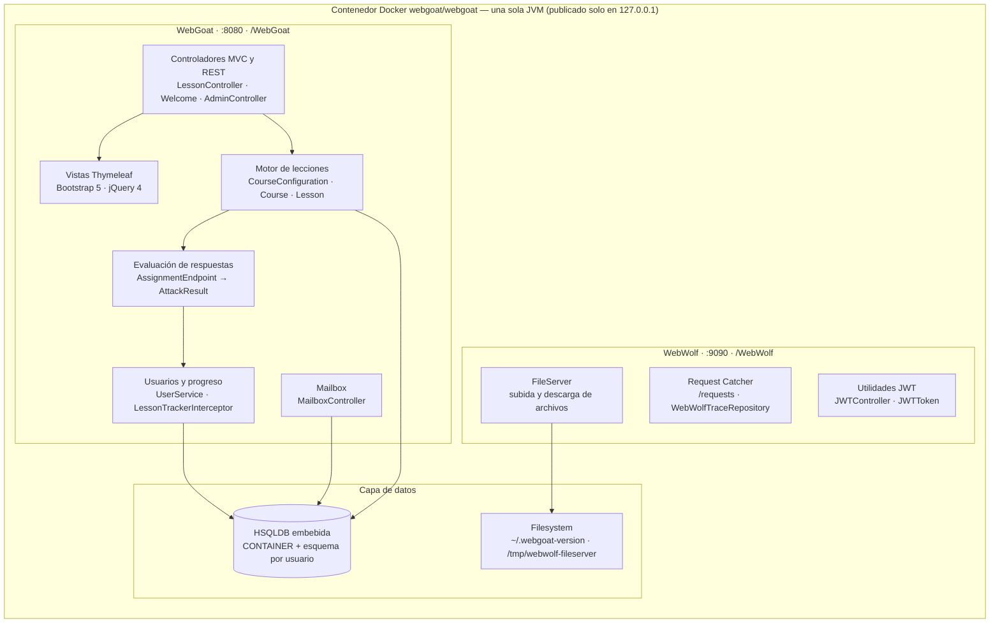
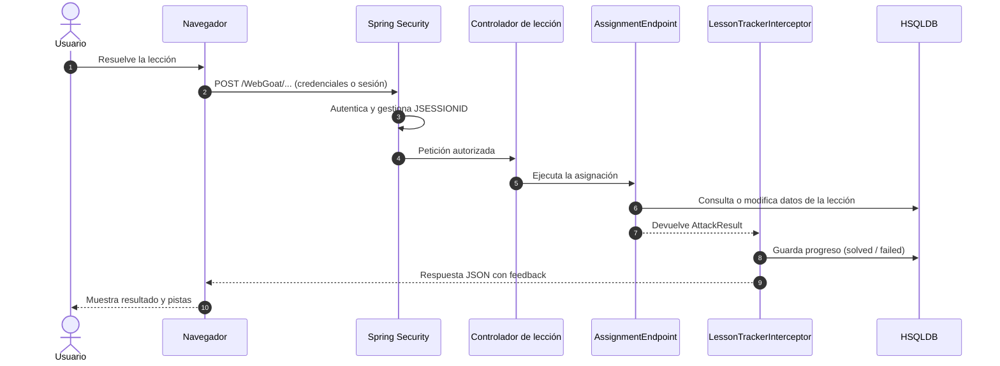
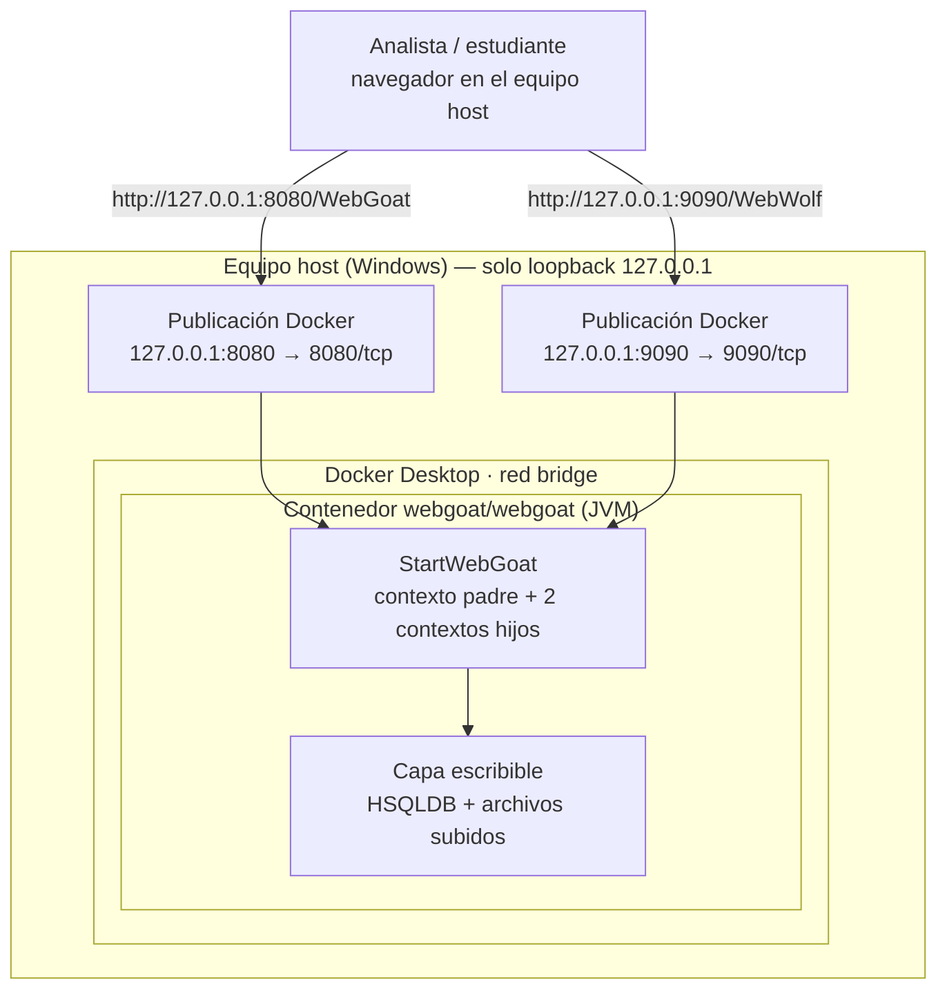

# Arquitectura y despliegue de OWASP WebGoat (Fase 1)

| Campo | Valor |
|---|---|
| Proyecto | Desarrollo Seguro de una Aplicación (SSDLC) — OWASP WebGoat |
| Versión analizada | Fork `2026.6-SNAPSHOT` |
| Responsable | Pablo Siquinajay — Fase 1 (diseño) |
| Fecha | 18 de noviembre de 2026 |
| Documentos relacionados | [`dfd.md`](dfd.md) · [`clasificacion-datos.md`](clasificacion-datos.md) · [`requisitos-asvs.md`](requisitos-asvs.md) |

## 1. Propósito y alcance

Este documento describe **cómo está construido y cómo se despliega** WebGoat, con el nivel de detalle necesario para: 

  a.  identificar componentes, límites de confianza y superficies de ataque; 

  b.  servir de base al DFD y al modelo de amenazas STRIDE (Fase 2); y 

  c. justificar los requisitos ASVS y los controles del pipeline.

El análisis se basa en el código fuente del fork (`pom.xml`, `src/main/java/org/owasp/webgoat/`, `Dockerfile`, archivos `application-*.properties`) y en la inspección de la aplicación publicada en Docker Hub (`webgoat/webgoat`) ejecutándose en local.

> **Advertencia:** WebGoat está diseñado para ser vulnerable. Este documento describe el diseño **tal como es**, sin corregir las vulnerabilidades didácticas. Cualquier endurecimiento se limita a la infraestructura del equipo y no altera las lecciones.

## 2. Stack tecnológico

| Capa | Tecnología | Evidencia |
|---|---|---|
| Lenguaje / runtime | Java 25 (source y target) | `pom.xml` → `java.version` |
| Framework | Spring Boot 4.1.2 (Spring MVC, Security, Data JPA, Actuator, OAuth2 Client) | `pom.xml` → `spring-boot-starter-parent` |
| Empaquetado | JAR ejecutable único `2026.6-SNAPSHOT` | `pom.xml` → `packaging=jar` |
| Vistas | Thymeleaf + Bootstrap 5.3.5 + jQuery 4.0.0 | `pom.xml`, `src/main/resources/` |
| Persistencia | HSQLDB embebida; esquema propiedad de Flyway (`V1__init.sql`, `V2`, `V3`); Hibernate DDL deshabilitado | `application-webgoat.properties`, `db/container/` |
| Build | Maven Wrapper 3.9.9 (único build soportado) | `.mvn/wrapper/`, `mvnw` |
| Calidad | Spotless + Google Java Format, Checkstyle, PMD | `pom.xml`, `config/checkstyle/` |
| Pruebas | JUnit 5 + Spring Test, REST Assured 6.x, Playwright 1.62 | `src/test/java`, `src/it/java` |
| Contenedor | Imagen `webgoat/webgoat` (Temurin 25 JDK, usuario no root) | `Dockerfile` |

## 3. Vista de componentes

WebGoat es un **monolito modular**: un único proceso JVM con un contexto padre (no web) y **dos contextos servlet hijos** creados en `StartWebGoat`:

- **WebGoat** — `http://127.0.0.1:8080/WebGoat`
- **WebWolf** — `http://127.0.0.1:9090/WebWolf`




### 3.1 Componentes y responsabilidades

| Componente | Responsabilidad | Código / recurso |
|---|---|---|
| Navegador | Interfaz de usuario; ejecuta HTML/JS de las lecciones y los ataques guiados | `src/main/resources/webgoat/static/`, plantillas Thymeleaf |
| Controladores WebGoat | Enrutado HTTP de lecciones, login, registro y administración | `container/controller/`, `container/users/RegistrationController.java`, `container/users/AdminController.java` |
| Motor de lecciones | Descubre `Lesson` y `AssignmentEndpoint` por paquete y construye el curso | `container/lessons/CourseConfiguration.java`, `Lesson.java`, `session/Course.java` |
| Evaluación de respuestas | Cada asignación devuelve un `AttackResult` (éxito/fallo, feedback, pistas) | `container/assignments/AssignmentEndpoint.java`, `AttackResult.java` |
| Progreso | Intercepta `AttackResult` y persiste intentos y asignaciones resueltas por usuario | `container/assignments/LessonTrackerInterceptor.java`, `users/UserProgress*` |
| Autenticación | Form login + OAuth2 (GitHub), roles `WEBGOAT_USER` y `WEBGOAT_ADMIN`, sesión HTTP | `container/WebSecurityConfig.java`, `users/WebGoatUser.java` |
| Mailbox | Buzón interno (bienvenida, reset de contraseña de lecciones) | `container/mailbox/MailboxController.java`, tablas `CONTAINER.email` |
| WebWolf | “Host del atacante”: catcher de peticiones, subida/descarga de archivos y utilidades JWT | `webwolf/FileServer.java`, `webwolf/requests/`, `webwolf/jwt/` |
| Persistencia | HSQLDB embebida en archivo; un esquema `CONTAINER` global y un esquema Flyway por usuario | `db/container/V1__init.sql`, `application-webgoat.properties` |
| Filesystem | Datos HSQLDB (`~/.webgoat-<versión>`) y archivos subidos a WebWolf (`/tmp/webwolf-fileserver/<usuario>`) | `FileServer.java`, propiedades `webgoat.server.directory` y `webwolf.fileserver.location` |

### 3.2 Modelo de datos principal

| Tabla (`CONTAINER`) | Contenido | Sensibilidad |
|---|---|---|
| `web_goat_user` | `username`, `password`, `role` (contraseña en texto plano por `NoOpPasswordEncoder`) | Alta |
| `user_progress` | Progreso agregado por usuario | Media |
| `lesson_progress` | Intentos y versión por lección | Baja-media |
| `assignment_progress` | Asignaciones resueltas | Baja-media |
| `email` | Buzón interno (`sender`, `recipient`, `title`, `contents`, `time`) | Media |
| Esquema `<username>` | Datos propios de cada lección (creado con `CREATE SCHEMA`) | Variable (según lección) |

## 4. Flujo de una petición




**Puntos clave del flujo**

1. La autenticación se resuelve en la cadena de filtros de Spring Security (`WebSecurityConfig`), con sesión HTTP (`JSESSIONID`) u OAuth2.
2. Las asignaciones se registran automáticamente en el curso según el paquete Java (`CourseConfiguration.attachToLesson`), sin configuración manual.
3. El progreso se persiste mediante un `ResponseBodyAdvice` (`LessonTrackerInterceptor`), que intercepta **cualquier** `AttackResult` devuelto.
4. El buzón interno se alimenta por HTTP (`POST /mail`), y las lecciones se envían correo a sí mismas a través de `webgoat.mail.url` (`127.0.0.1`).

## 5. Despliegue en Docker




### 5.1 Imagen y configuración

- `Dockerfile`: base `eclipse-temurin:25-jdk-noble`, usuario **no root** (`USER webgoat`), `EXPOSE 8080 9090`, entrypoint con `--server.address=0.0.0.0` (escucha en todas las interfaces **dentro** del contenedor).
- La imagen publicada `webgoat/webgoat` contiene el JAR ya construido; para el fork se puede construir localmente con `.\mvnw -DskipTests package` y `docker build -t webgoat-fork .`.
- Datos persistentes en la capa escribible del contenedor (`~/.webgoat-<versión>` y `/tmp/webwolf-fileserver`); al eliminar el contenedor se pierden usuarios y progreso.

### 5.2 Ejecución segura en local (obligatorio)

Como la aplicación es vulnerable por diseño, **nunca debe publicarse en todas las interfaces del host**. La publicación debe quedar restringida a loopback:

```bash
docker run -d --name webgoat \
  -p 127.0.0.1:8080:8080 \
  -p 127.0.0.1:9090:9090 \
  webgoat/webgoat
```

Verificación de que solo escucha en local:

```bash
docker port webgoat
# 8080/tcp -> 127.0.0.1:8080
# 9090/tcp -> 127.0.0.1:9090
```

> El `--server.address=0.0.0.0` del `Dockerfile` es interno al contenedor; la restricción efectiva la impone la publicación `127.0.0.1:puerto_host:puerto_contenedor`. Si se usa `-p 8080:8080` (sin IP), Docker publica en `0.0.0.0` y expone la aplicación vulnerable a la red local/Internet.

### 5.3 Alternativa de escritorio

`webgoat-desktop` (`docker run -p 127.0.0.1:3000:3000 webgoat/webgoat-desktop`) ofrece un escritorio accesible por navegador. No es necesario para esta fase: el contenedor estándar cubre WebGoat y WebWolf.

## 6. Superficie de ataque y notas de seguridad

| Superficie | Descripción | Implicación |
|---|---|---|
| `:8080/WebGoat` | Login, registro, lecciones, mailbox, actuator | Principal superficie web; el actuator expone `env`, `health` y `configprops` sin autenticación |
| `:9090/WebWolf` | Catcher, subida/descarga de archivos, JWT | Subida de archivos sin autenticación (`POST /files`) por diseño de las lecciones |
| HSQLDB | Archivo local dentro del contenedor | No expuesta por red, pero accesible si se compromete la app |
| Filesystem | Uploads y datos de lecciones | Riesgo de path traversal en lecciones; no debe montarse el filesystem del host |
| Red Docker | Publicación de puertos | Debe limitarse a `127.0.0.1` |

**Deuda de seguridad conocida (no se corrige en esta fase):** CSRF y cabeceras de seguridad deshabilitadas (`WebSecurityConfig`), contraseñas en texto plano (`NoOpPasswordEncoder`), trazas de error expuestas (`spring.web.error.include-stacktrace=always`), y las vulnerabilidades didácticas de cada lección. Su tratamiento se planifica en la Fase 7 (remediación) y se justifica mediante la política de bloqueo y VEX.

## 7. Trazabilidad

- Actores, flujos y límites de confianza: [`dfd.md`](dfd.md)
- Datos y sensibilidad: [`clasificacion-datos.md`](clasificacion-datos.md)
- Requisitos verificables: [`requisitos-asvs.md`](requisitos-asvs.md)
