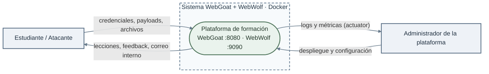
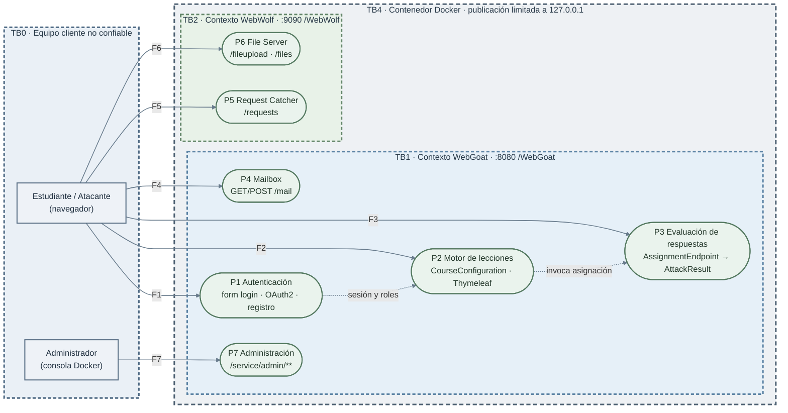
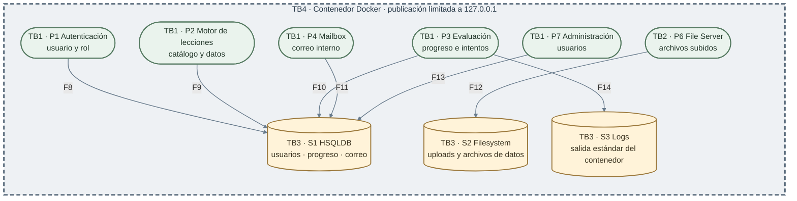

# Diagrama de Flujo de Datos (DFD) y límites de confianza (Fase 1)

| Campo | Valor |
|---|---|
| Proyecto | Desarrollo Seguro de una Aplicación (SSDLC) — OWASP WebGoat |
| Versión analizada | Fork `2026.6-SNAPSHOT` |
| Responsable | Pablo Siquinajay — Fase 1 (diseño) |
| Fecha | 18 de noviembre de 2026 |
| Base | [`arquitectura.md`](arquitectura.md) · [`clasificacion-datos.md`](clasificacion-datos.md) |

## 1. Propósito y alcance

Este DFD modela **qué datos entran, se transforman y salen** de WebGoat/WebWolf, y **dónde cambian de dueño**. Es la entrada directa del modelo de amenazas STRIDE de la Fase 2: cada flujo y cada límite de confianza se numera para poder trazar amenazas → mitigación → requisito ASVS → control del pipeline.

**Alcance:** proceso JVM único desplegado en un contenedor Docker, con los contextos WebGoat (`:8080`) y WebWolf (`:9090`), su base HSQLDB embebida y el filesystem del contenedor. **Fuera de alcance:** infraestructura del host, GitHub Actions y servicios externos de OAuth2 (se modelan solo como flujos de salida).

## 2. Convenciones

| Elemento | Representación | Ejemplos |
|---|---|---|
| Actor externo | Rectángulo de esquinas rectas (`[texto]`), relleno azul grisáceo | Estudiante/Atacante, Administrador |
| Proceso | Forma redondeada tipo estadio (`([texto])`), relleno verde tenue | Autenticación, Evaluación de respuestas |
| Almacén de datos | Cilindro (`[(texto)]`), relleno amarillo tenue | HSQLDB, filesystem, logs |
| Flujo de datos | Flecha etiquetada `Fn` | `F1 credenciales` |
| Almacén (identificador) | Prefijo `Sn` dentro del cilindro | `S1 HSQLDB` |
| Límite/zona de confianza | Subgrafo con marco y encabezado `TBn`; en la vista de persistencia, el ID de zona va en la etiqueta del nodo para evitar cruces de flechas | `TB0` cliente; `TB4` contenedor |

Las formas y etiquetas identifican los elementos incluso al imprimir en escala de grises. Los tonos pastel distinguen actores, procesos y almacenes; el encabezado y el marco indican la zona de confianza. Las flechas que entran o salen del marco representan flujos que cruzan ese límite.

## 3. DFD de contexto (nivel 0)

Versión PNG: [`dfd-contexto.png`](assets/dfd-contexto.png).

## 4. DFD de nivel 1 con límites de confianza

Para reducir cruces y facilitar la lectura, el nivel 1 se presenta en dos vistas complementarias. Los IDs de proceso, flujo y zona son los mismos en las figuras y en las tablas de este documento.

### 4.1 Vista A: interacción entre actores y procesos

Versión PNG: [`dfd-nivel1.png`](assets/dfd-nivel1.png).

### 4.2 Vista B: procesos y almacenes de datos

En esta vista cada proceso y almacén lleva su zona `TBn` en la etiqueta. Esto mantiene las relaciones de flujo directas y evita que el borde del subgrafo oculte las flechas.

Versión PNG: [`dfd-nivel1-datos.png`](assets/dfd-nivel1-datos.png).

### 4.3 Actores externos

| Actor | Descripción | Confianza |
|---|---|---|
| Estudiante / Atacante | Usuario que resuelve lecciones y ejecuta ataques guiados (XSS, CSRF, SSRF, etc.) | No confiable |
| Administrador | Operador del contenedor y de la cuenta `WEBGOAT_ADMIN`; puede gestionar usuarios | Semiconfiable (credenciales propias) |
| Servicios externos | OAuth2 de GitHub para login social (solo salida) | Tercero |

### 4.4 Procesos

| ID | Proceso | Entradas | Salidas | Código |
|---|---|---|---|---|
| P1 | Autenticación y registro | Credenciales, callback OAuth2 | Sesión `JSESSIONID`, rol | `container/WebSecurityConfig.java`, `users/RegistrationController.java` |
| P2 | Motor de lecciones | Petición de lección, usuario autenticado | HTML de lección, menú, pistas | `container/lessons/`, `container/session/Course.java` |
| P3 | Evaluación de respuestas | Payloads de la lección | `AttackResult` (éxito/fallo, feedback) | `container/assignments/`, `lessons/**` |
| P4 | Mailbox | Envío/lectura de correo | Correo del usuario | `container/mailbox/MailboxController.java` |
| P5 | Request Catcher (WebWolf) | Peticiones HTTP de las lecciones | Traza y visualización | `webwolf/requests/` |
| P6 | File Server (WebWolf) | Archivos multipart | Archivo almacenado y enlace | `webwolf/FileServer.java` |
| P7 | Administración | Acciones de admin | Altas, listado y reset de usuarios | `container/users/AdminController.java` |

### 4.5 Almacenes de datos

| ID | Almacén | Contenido | Ubicación |
|---|---|---|---|
| S1 | HSQLDB | `web_goat_user`, `user_progress`, `lesson_progress`, `assignment_progress`, `email` y esquemas por usuario | Archivo en `~/.webgoat-<versión>/webgoat` |
| S2 | Filesystem | Archivos subidos y datos de la base | `/tmp/webwolf-fileserver/<usuario>` y directorio de usuario de la app |
| S3 | Logs | Eventos de aplicación y trazas de error | Salida estándar / `docker logs` |

### 4.6 Flujos de datos

| Flujo | Origen → Destino | Datos | Canal | Cifrado |
|---|---|---|---|---|
| F1 | Estudiante → P1 | Usuario, contraseña, token OAuth2 | HTTP POST | No por defecto (TLS opcional) |
| F2 | Estudiante → P2 | Rutas, parámetros, cookies de sesión | HTTP | No por defecto |
| F3 | Estudiante → P3 | Payloads de ataque (SQLi, XSS, etc.) | HTTP/JSON | No por defecto |
| F4 | Estudiante → P4 | Correo leído/enviado | HTTP | No por defecto |
| F5 | Estudiante → P5 | Peticiones capturadas (cookies robadas, callbacks) | HTTP | No por defecto |
| F6 | Estudiante → P6 | Archivos multipart | HTTP | No por defecto |
| F7 | Administrador → P7 | Gestión de usuarios | HTTP autenticado | No por defecto |
| F8 | P1 → S1 | Credenciales (texto plano), rol | JDBC local | N/A (local) |
| F9 | P2 → S1 | Catálogo y datos de lecciones | JDBC local | N/A |
| F10 | P3 → S1 | Progreso e intentos | JDBC local | N/A |
| F11 | P4 → S1 | Correo interno | JDBC local | N/A |
| F12 | P6 → S2 | Archivos subidos | Sistema de archivos | N/A |
| F13 | P7 → S1 | Altas y modificaciones de usuarios | JDBC local | N/A |
| F14 | P3 → S3 | Errores, trazas y eventos | Logging | N/A |

## 5. Límites de confianza

| ID | Frontera | Qué la cruza | Riesgo principal |
|---|---|---|---|
| **TB0** | Zona del navegador/host no confiable; su perímetro marca la frontera cliente-aplicación | Peticiones HTTP entrantes, credenciales, payloads | Suplantación, manipulación, XSS, CSRF e inyección |
| **TB1** | Zona del contexto WebGoat (`:8080`) frente a WebWolf y los almacenes | Autenticación, lecciones, mailbox y administración | Abuso de sesión, acceso a datos ajenos o elevación de privilegios |
| **TB2** | Zona WebWolf (`:9090`), separada lógicamente de WebGoat | Callbacks, peticiones capturadas y archivos | Exfiltración de cookies o uso de WebWolf como host de ataque |
| **TB3** | Zona de almacenes frente a los procesos de aplicación | JDBC, archivos y logs | Lectura o modificación indebida de datos |
| **TB4** | Zona del contenedor Docker; su perímetro separa la aplicación del equipo host | Puertos publicados y almacenamiento del contenedor | Exposición de la app vulnerable fuera de `127.0.0.1` |

**Lectura de las figuras.** Los marcos de las zonas llevan su ID `TBn` en el encabezado; en la vista de persistencia, los nodos llevan el prefijo de zona en su etiqueta para conservar flechas directas. El contenedor `TB4` encierra los contextos WebGoat (`TB1`), WebWolf (`TB2`) y los almacenes (`TB3`). WebGoat y WebWolf comparten contenedor/JVM, pero tienen contextos y puertos distintos, sesiones separadas (`JSESSIONID` y `WEBWOLFSESSION`) y funciones de confianza distintas. La frontera de despliegue `TB4` se detalla también en [`arquitectura.md`](arquitectura.md) §5.

## 6. Preparación para STRIDE (Fase 2)

| Límite / flujo | S (Spoofing) | T (Tampering) | R (Repudiation) | I (Info disclosure) | D (DoS) | E (Elevation) |
|---|---|---|---|---|---|---|
| TB0 (F1–F7) | Credenciales débiles, sesión | Payloads manipulados | Falta de auditoría de acciones | Cookies/tokens, trazas de error | Rate limiting ausente | IDOR y acceso a admin |
| TB1 (P1–P4, P7) | Suplantación de sesión | Inyección SQL desde lecciones | Progreso no auditable | Datos de otros usuarios en BD | Consultas costosas | Esquema por usuario mal aislado |
| TB2 (P5–P6, F5–F6, F12) | Suplantación vía catcher | Archivos manipulados | Sin trazabilidad de subidas | Exfiltración de cookies | Subida masiva | Ejecución desde uploads |
| TB3 (F8–F14) | — | Escritura directa en BD | Sin auditoría de cambios | Lectura masiva de datos | Bloqueo de la BD | Acceso a esquemas de otros usuarios |
| TB4 (host) | — | Configuración del contenedor | — | Puertos expuestos | Consumo de recursos | Escape de contenedor / montajes |

> El modelo completo (≥12 amenazas, con impacto, probabilidad, prioridad y mitigación) se entrega en la Fase 2 con OWASP Threat Dragon, reutilizando los identificadores `Fn`, `Sn`, `Pn` y `TBn` de este documento.

## 7. Supuestos y limitaciones

- Se modela el despliegue **local en Docker con publicación en `127.0.0.1`**, que es el entorno autorizado del equipo.
- No se modelan servicios externos de OAuth2 más allá del flujo de salida.
- El buzón se ejecuta dentro de WebGoat (no hay servidor SMTP real): el correo se envía por HTTP a `127.0.0.1`.
- Las lecciones pueden crear esquemas y tablas propias por usuario; el DFD las agrupa en el almacén S1.
