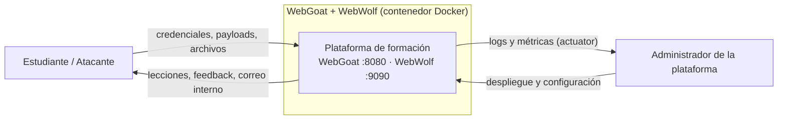
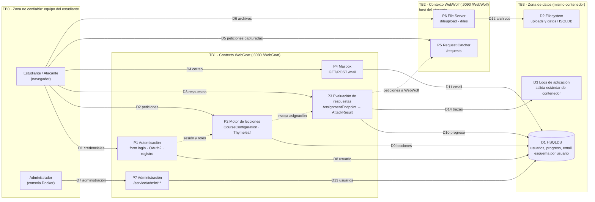

# Diagrama de Flujo de Datos (DFD) y límites de confianza (Fase 1)

| Campo | Valor |
|---|---|
| Proyecto | Desarrollo Seguro de una Aplicación (SSDLC) — OWASP WebGoat |
| Versión analizada | Fork `2026.6-SNAPSHOT` |
| Responsable | Estudiante A — Fase 1 (diseño) |
| Fecha | 18 de noviembre de 2026 |
| Base | [`arquitectura.md`](arquitectura.md) · [`clasificacion-datos.md`](clasificacion-datos.md) |

## 1. Propósito y alcance

Este DFD modela **qué datos entran, se transforman y salen** de WebGoat/WebWolf, y **dónde cambian de dueño**. Es la entrada directa del modelo de amenazas STRIDE de la Fase 2: cada flujo y cada límite de confianza se numera para poder trazar amenazas → mitigación → requisito ASVS → control del pipeline.

**Alcance:** proceso JVM único desplegado en un contenedor Docker, con los contextos WebGoat (`:8080`) y WebWolf (`:9090`), su base HSQLDB embebida y el filesystem del contenedor. **Fuera de alcance:** infraestructura del host, GitHub Actions y servicios externos de OAuth2 (se modelan solo como flujos de salida).

## 2. Convenciones

| Elemento | Representación | Ejemplos |
|---|---|---|
| Actor externo | Rectángulo | Estudiante/Atacante, Administrador |
| Proceso | Rectángulo redondeado | Autenticación, Evaluación de respuestas |
| Almacén de datos | Cilindro | HSQLDB, filesystem |
| Flujo de datos | Flecha etiquetada `Dn` | `D1 credenciales` |
| Límite de confianza | Subgrafo `TBn` | Navegador ↔ contenedor |

## 3. DFD de contexto (nivel 0)

## 4. DFD de nivel 1 con límites de confianza

### 4.1 Actores externos

| Actor | Descripción | Confianza |
|---|---|---|
| Estudiante / Atacante | Usuario que resuelve lecciones y ejecuta ataques guiados (XSS, CSRF, SSRF, etc.) | No confiable |
| Administrador | Operador del contenedor y de la cuenta `WEBGOAT_ADMIN`; puede gestionar usuarios | Semiconfiable (credenciales propias) |
| Servicios externos | OAuth2 de GitHub para login social (solo salida) | Tercero |

### 4.2 Procesos

| ID | Proceso | Entradas | Salidas | Código |
|---|---|---|---|---|
| P1 | Autenticación y registro | Credenciales, callback OAuth2 | Sesión `JSESSIONID`, rol | `container/WebSecurityConfig.java`, `users/RegistrationController.java` |
| P2 | Motor de lecciones | Petición de lección, usuario autenticado | HTML de lección, menú, pistas | `container/lessons/`, `container/session/Course.java` |
| P3 | Evaluación de respuestas | Payloads de la lección | `AttackResult` (éxito/fallo, feedback) | `container/assignments/`, `lessons/**` |
| P4 | Mailbox | Envío/lectura de correo | Correo del usuario | `container/mailbox/MailboxController.java` |
| P5 | Request Catcher (WebWolf) | Peticiones HTTP de las lecciones | Traza y visualización | `webwolf/requests/` |
| P6 | File Server (WebWolf) | Archivos multipart | Archivo almacenado y enlace | `webwolf/FileServer.java` |
| P7 | Administración | Acciones de admin | Altas, listado y reset de usuarios | `container/users/AdminController.java` |

### 4.3 Almacenes de datos

| ID | Almacén | Contenido | Ubicación |
|---|---|---|---|
| D1 | HSQLDB | `web_goat_user`, `user_progress`, `lesson_progress`, `assignment_progress`, `email` y esquemas por usuario | Archivo en `~/.webgoat-<versión>/webgoat` |
| D2 | Filesystem | Archivos subidos y datos de la base | `/tmp/webwolf-fileserver/<usuario>` y directorio de usuario de la app |
| D3 | Logs | Eventos de aplicación y trazas de error | Salida estándar / `docker logs` |

### 4.4 Flujos de datos

| Flujo | Origen → Destino | Datos | Canal | Cifrado |
|---|---|---|---|---|
| D1 | Estudiante → P1 | Usuario, contraseña, token OAuth2 | HTTP POST | No por defecto (TLS opcional) |
| D2 | Estudiante → P2 | Rutas, parámetros, cookies de sesión | HTTP | No por defecto |
| D3 | Estudiante → P3 | Payloads de ataque (SQLi, XSS, etc.) | HTTP/JSON | No por defecto |
| D4 | Estudiante → P4 | Correo leído/enviado | HTTP | No por defecto |
| D5 | Estudiante → P5 | Peticiones capturadas (cookies robadas, callbacks) | HTTP | No por defecto |
| D6 | Estudiante → P6 | Archivos multipart | HTTP | No por defecto |
| D7 | Administrador → P7 | Gestión de usuarios | HTTP autenticado | No por defecto |
| D8 | P1 → D1 | Credenciales (texto plano), rol | JDBC local | N/A (local) |
| D9 | P2 → D1 | Catálogo y datos de lecciones | JDBC local | N/A |
| D10 | P3 → D1 | Progreso e intentos | JDBC local | N/A |
| D11 | P4 → D1 | Correo interno | JDBC local | N/A |
| D12 | P6 → D2 | Archivos subidos | Sistema de archivos | N/A |
| D13 | P7 → D1 | Altas y modificaciones de usuarios | JDBC local | N/A |
| D14 | P3 → D3 | Errores, trazas y eventos | Logging | N/A |

## 5. Límites de confianza

| ID | Frontera | Qué la cruza | Riesgo principal |
|---|---|---|---|
| **TB0** | Navegador/host ↔ contenedor | Todo el tráfico HTTP de usuarios y atacantes | Suplantación, tampering, XSS, CSRF, inyección |
| **TB1** | Contexto WebGoat ↔ zona de datos | Acceso JDBC y de filesystem desde los procesos | Elevación de privilegios desde una lección vulnerable al resto de la app |
| **TB2** | WebGoat ↔ WebWolf | Peticiones y archivos entre contextos, enlaces de lecciones | Uso de WebWolf como canal de exfiltración o de entrega de payloads |
| **TB3** | Procesos ↔ almacenes internos (HSQLDB/filesystem) | Consultas y escrituras locales | Corrupción de datos, lectura de datos de otros usuarios |
| **TB4** | Contenedor ↔ host | Publicación de puertos, volumen de datos | Exposición de la app vulnerable fuera de `127.0.0.1` |

**Justificación de TB2.** Aunque WebGoat y WebWolf comparten contenedor y JVM, son contextos y puertos distintos con sesiones separadas (`JSESSIONID` vs `WEBWOLFSESSION`). Para el modelado se tratan como zonas distintas porque WebWolf representa el “host del atacante” y sus endpoints públicos (`/files`, `/requests`) son alcanzables sin sesión de WebGoat.

## 6. Preparación para STRIDE (Fase 2)

| Límite / flujo | S (Spoofing) | T (Tampering) | R (Repudiation) | I (Info disclosure) | D (DoS) | E (Elevation) |
|---|---|---|---|---|---|---|
| TB0 (D1–D6) | Credenciales débiles, sesión | Payloads manipulados | Falta de auditoría de acciones | Cookies/tokens, trazas de error | Rate limiting ausente | IDOR y acceso a admin |
| TB1 (D8–D14) | — | Inyección SQL desde lecciones | Progreso no auditable | Datos de otros usuarios en BD | Consultas costosas | Esquema por usuario mal aislado |
| TB2 (WebGoat↔WebWolf) | Suplantación vía catcher | Archivos manipulados | Sin trazabilidad de subidas | Exfiltración de cookies | Subida masiva | Ejecución desde uploads |
| TB3 (datos) | — | Escritura directa en BD | Sin auditoría de cambios | Lectura masiva de datos | Bloqueo de la BD | Acceso a esquemas de otros usuarios |
| TB4 (host) | — | Configuración del contenedor | — | Puertos expuestos | Consumo de recursos | Escape de contenedor / montajes |

> El modelo completo (≥12 amenazas, con impacto, probabilidad, prioridad y mitigación) se entrega en la Fase 2 con OWASP Threat Dragon, reutilizando los identificadores `Dn`/`TBn` de este documento.

## 7. Supuestos y limitaciones

- Se modela el despliegue **local en Docker con publicación en `127.0.0.1`**, que es el entorno autorizado del equipo.
- No se modelan servicios externos de OAuth2 más allá del flujo de salida.
- El buzón se ejecuta dentro de WebGoat (no hay servidor SMTP real): el correo se envía por HTTP a `127.0.0.1`.
- Las lecciones pueden crear esquemas y tablas propias por usuario; el DFD las agrupa en D1.
