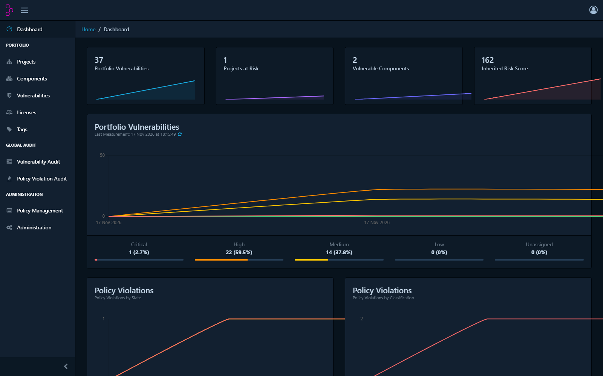
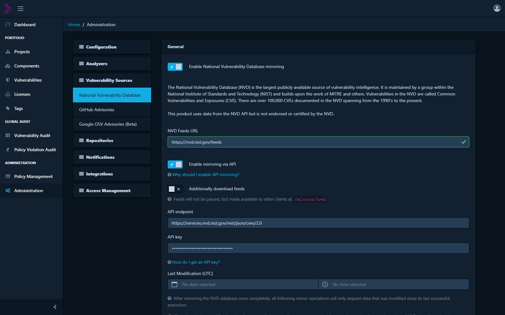
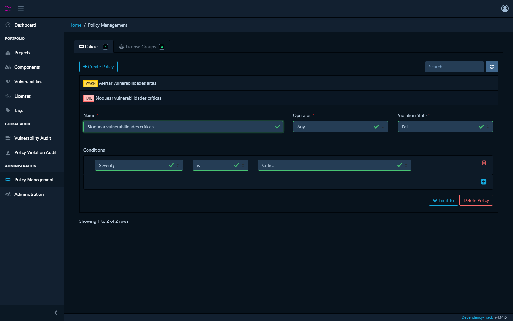
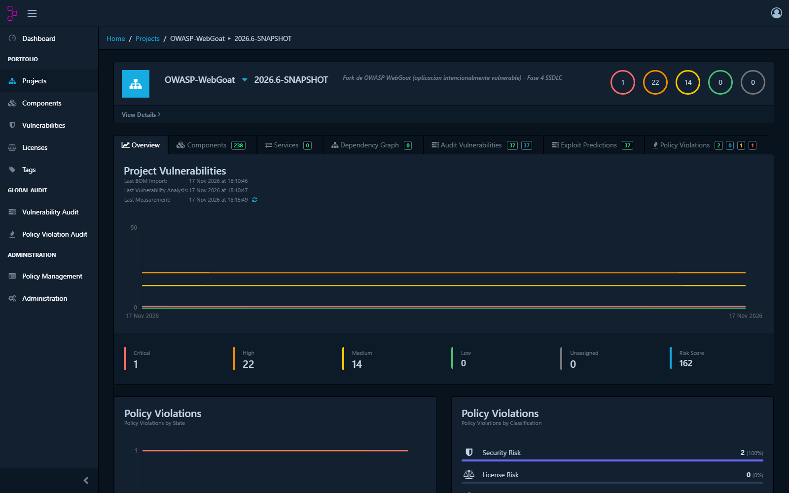
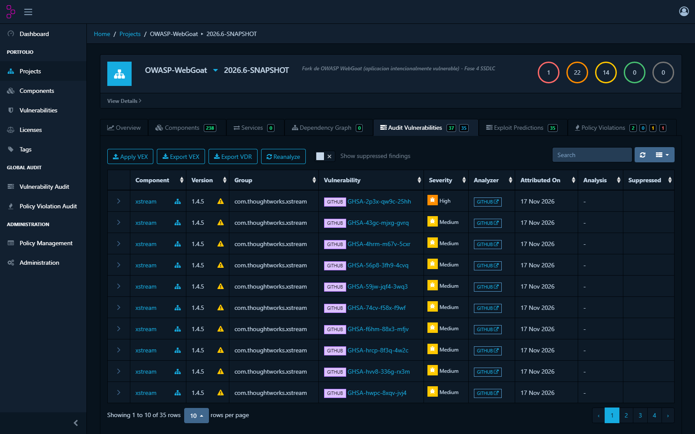
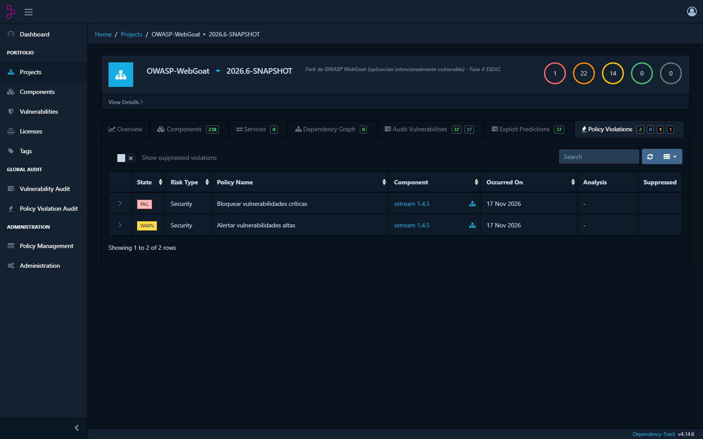

# OWASP Dependency-Track local con la API key del NVD (Fase 4, pasos C.1 y C.2)

**Responsable:** Estudiante C · **Versión:** Dependency-Track **4.14.6** (API server + frontend) en Docker Desktop.

## Por qué Dependency-Track 4.14 y no 5.x

El `docker-compose.yml` que publica hoy dependencytrack.org instala la versión 5.2.x. En la 5.x el NVD se replica
desde los *JSON 2.0 feeds* masivos y **ya no hay campo para la API key del NVD**. Como esta entrega pide sincronizar el
NVD con nuestra **API key**, fijamos la última línea 4.x (4.14.6). Esa versión todavía tiene
*Administration → Vulnerability Sources → NVD → Enable mirroring via API*.

## Puesta en marcha

```bash
cd security/dtrack
docker compose up -d          # frontend http://localhost:8080 · API http://localhost:8081
```

- **Memoria:** el API server tiene un límite de 5 GB y una reserva de 3 GB. Docker Desktop necesita unos 4 GB libres.
- **Conflicto de puerto:** WebGoat también usa el 8080. Detén el contenedor `webgoat` antes de levantar este stack.
- **Contraseña:** el primer ingreso es `admin` / `admin` y Dependency-Track obliga a cambiarla. La nueva contraseña
  **no** se guarda en el repositorio.

## Configuración aplicada (C.1)

| Paso | Dónde | Valor |
|---|---|---|
| NVD con API key | Administration → Vulnerability Sources → National Vulnerability Database | *Enable NVD mirroring* ✅, *Enable mirroring via API* ✅, API key del equipo (se guarda cifrada en DT y nunca en Git) |
| OSV (complemento) | Administration → Vulnerability Sources → Google OSV Advisories | Ecosistema `Maven` |
| EPSS | Activo por defecto en 4.14 | El feed por defecto (`epss.cyentia.com`) no había poblado datos al momento de la captura. Los valores EPSS de la priorización salen de la API de FIRST y de Grype. |
| Proyecto | Projects → Create Project | `OWASP-WebGoat`, versión `2026.6-SNAPSHOT`, clasificador `Application` |
| Política 1 (bloqueo) | Policy Management | **"Bloquear vulnerabilidades críticas"**: condición `Severity IS CRITICAL`, estado **FAIL** |
| Política 2 (alerta) | Policy Management | "Alertar vulnerabilidades altas": `Severity IS HIGH`, estado **WARN** |

> La API key del NVD se pega solo en la interfaz o la API **local** de Dependency-Track. **No** se agrega como secreto
> del repositorio: el job `sca` de GitHub Actions usa Grype, que trae su propia base de datos (NVD + GHSA + EPSS + KEV)
> y no consulta la API del NVD.

## Carga del SBOM (C.2)

Se puede hacer desde la interfaz (*Projects → OWASP-WebGoat → Components → Upload BOM*) o por API:

```bash
curl -X POST http://localhost:8081/api/v1/bom \
  -H "X-Api-Key: <api-key-de-un-team-con-BOM_UPLOAD>" \
  -F "projectName=OWASP-WebGoat" -F "projectVersion=2026.6-SNAPSHOT" \
  -F "bom=@security/sbom/sbom-webgoat.cdx.json"
```

## Resultado y evidencias

| Métrica | Valor |
|---|---|
| Componentes | 238 (el SBOM tiene 239 entradas Maven, una duplicada: `bcprov-jdk18on`) |
| Vulnerabilidades | **37**: 1 Critical · 22 High · 14 Medium · 0 Low (coincide con Grype) |
| Componentes vulnerables | 2 (`xstream 1.4.5`, `commons-lang3 3.14.0`) |
| Violaciones de política | **1 FAIL** ("Bloquear vulnerabilidades críticas" → `xstream 1.4.5`) · 1 WARN |

| Captura | Descripción |
|---|---|
|  | Dashboard de portafolio con el proyecto WebGoat cargado |
|  | Fuente NVD con *mirroring via API* activo y la API key configurada (oculta) |
|  | Política de seguridad `Severity IS CRITICAL → FAIL` |
|  | Proyecto `OWASP-WebGoat 2026.6-SNAPSHOT` con el SBOM importado |
|  | Auditoría de vulnerabilidades (37 hallazgos, 35 visibles: los 2 `not_affected` del VEX quedan suprimidos) |
|  | Política disparada: **FAIL** por XStream 1.4.5 |

### Estado de la sincronización con el NVD

La réplica vía API arrancó con la API key y avanza por páginas de 2 000 CVEs. La réplica **inicial** del NVD completo
(~427 000 CVEs) tarda varias horas en una laptop con base H2. Las siguientes son incrementales. Extracto del log
(`docker compose logs apiserver`):

```text
INFO [NistApiMirrorTask] CVEs were not previously mirrored via NVD API; Will mirror all CVEs
INFO [NistApiMirrorTask] Mirrored 2000/427456 CVEs (0%)
...
INFO [NistApiMirrorTask] Mirrored 52000/427499 CVEs (12%)
```

Mientras la réplica del NVD termina, los hallazgos de WebGoat salen de **OSV (Maven)**, que se replicó completo en
unos 45 s (7 258 avisos). Las coincidencias por `purl` en Maven son más precisas que las de CPE del NVD.

## Decisiones VEX registradas en Dependency-Track

Las 4 declaraciones de [`../vex/vex-webgoat.json`](../vex/vex-webgoat.json) también quedaron como análisis de auditoría
en el proyecto:

| Hallazgo | Estado | Detalle |
|---|---|---|
| CVE-2025-48924, CVE-2024-47072 | `NOT_AFFECTED` · `CODE_NOT_REACHABLE` · suprimido | Código vulnerable fuera de la ruta de ejecución |
| CVE-2013-7285, CVE-2021-39144 | `EXPLOITABLE` · `WILL_NOT_FIX` | Vulnerabilidad intencional de la lección, mitigada con aislamiento |

DT exporta esas decisiones en formato CycloneDX VEX: *Audit Vulnerabilities → Export VEX*, o
`GET /api/v1/vex/cyclonedx/project/{uuid}`. El resultado se guardó en
[`../vex/vex-webgoat.cdx.json`](../vex/vex-webgoat.cdx.json).
