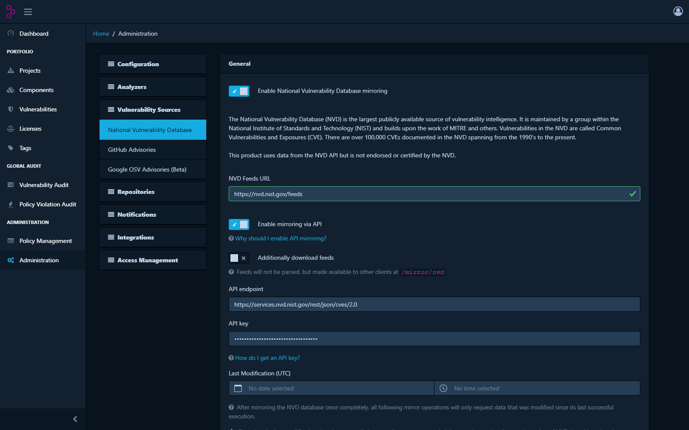
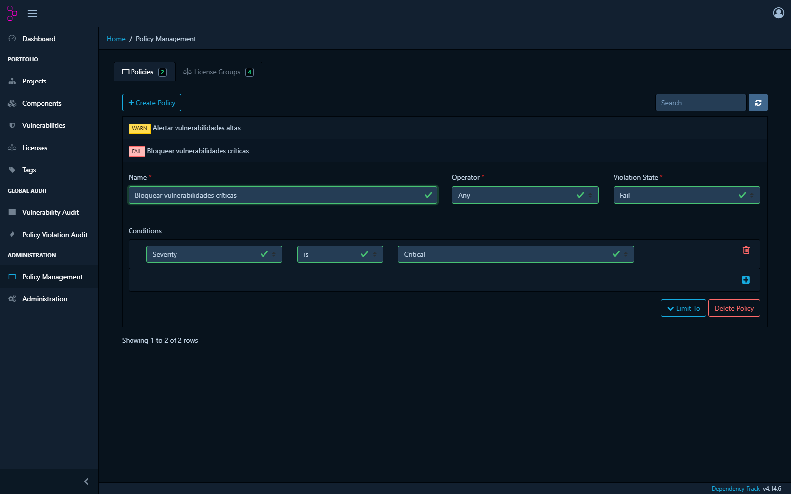
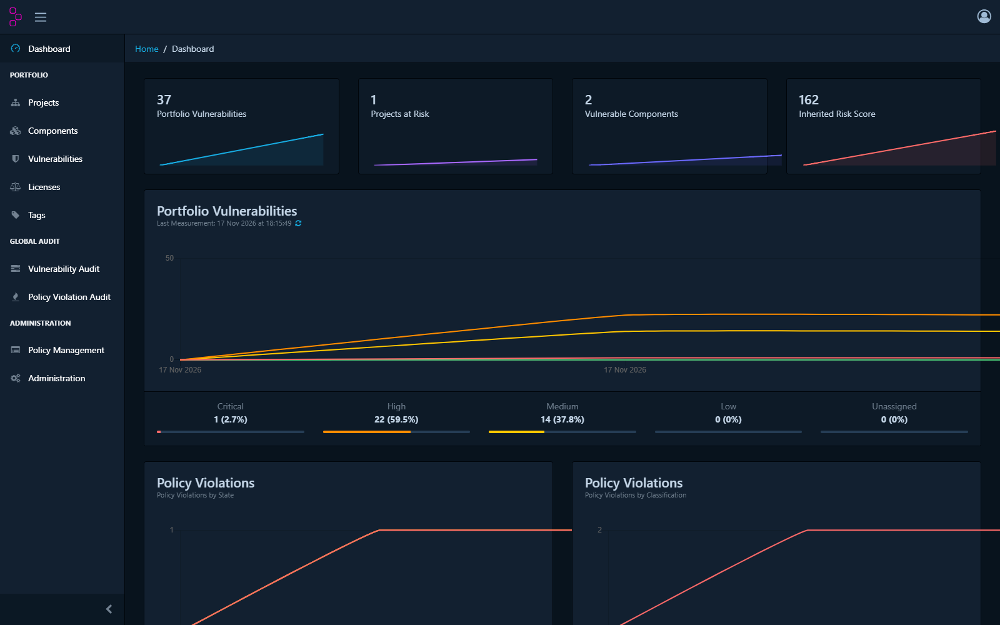
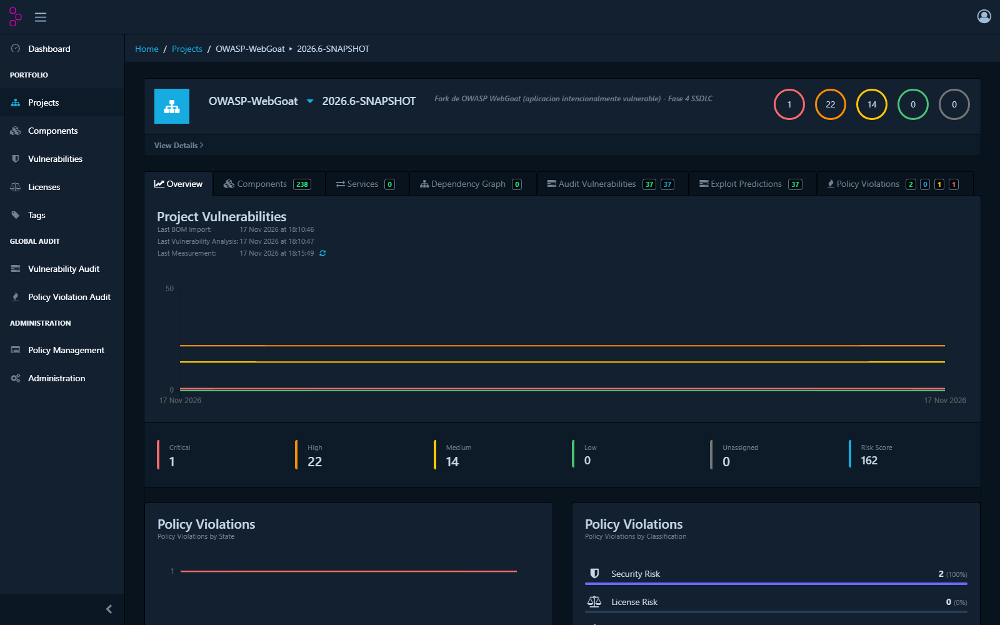
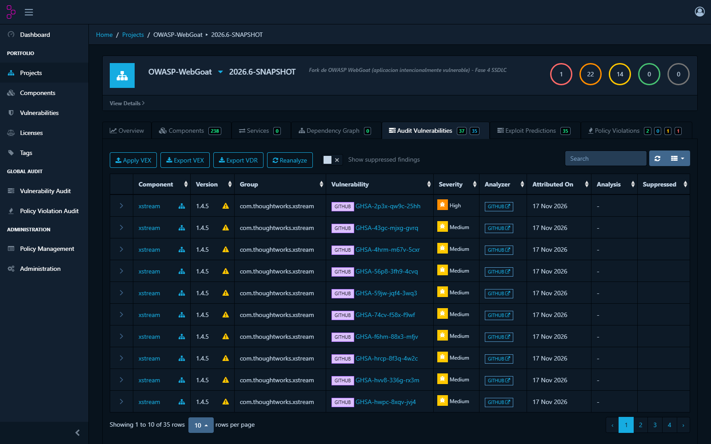
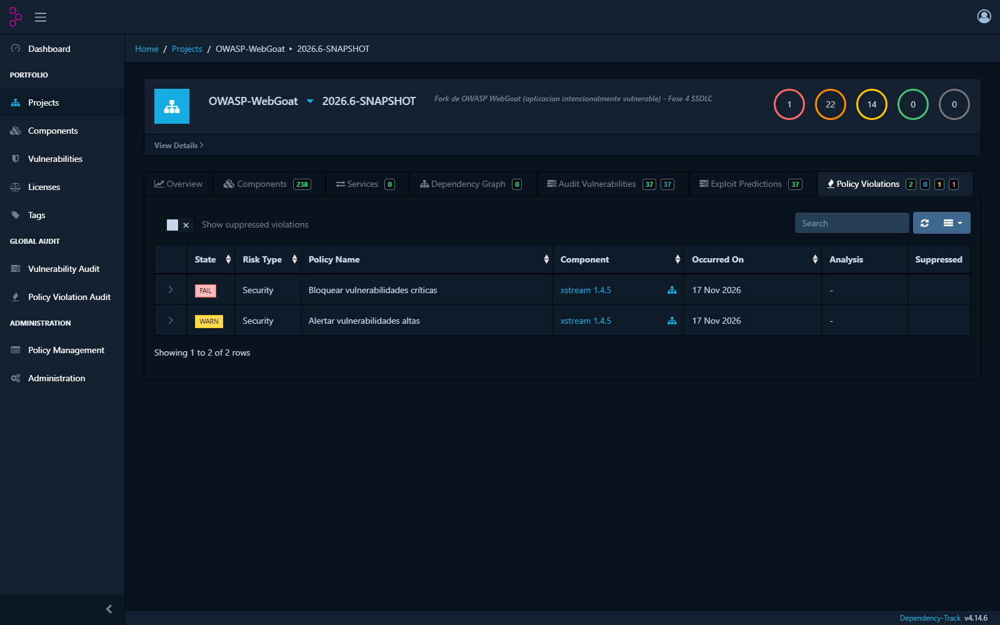

# Reporte de avance: Christian Sosa (Fase 4: SCA, SBOM, Dependency-Track y VEX)

**Proyecto:** SSDLC sobre OWASP WebGoat (fork `Pablokill2004/WebGoat-VulnerableLessonApp-Forked`)
**Entrega:** Segunda entrega (avance obligatorio) · Miércoles 18-nov-2026 (Clase 8)
**Fecha de corte de los datos:** 17-nov-2026
**Rol:** Christian Sosa, *Dependencias SCA, SBOM CycloneDX, Dependency-Track y VEX*

---

## 1. Resumen ejecutivo

| Indicador | Resultado |
|---|---|
| Componentes inventariados (SBOM CycloneDX 1.7) | **239** paquetes Maven (directos y transitivos) |
| Vulnerabilidades detectadas (Grype = Dependency-Track) | **37**: 1 Critical · 22 High · 14 Medium · 0 Low |
| Componentes vulnerables | **2**: `xstream 1.4.5` (36 hallazgos) y `commons-lang3 3.14.0` (1) |
| CVEs en CISA KEV | **1**: CVE-2021-39144 (XStream) |
| Gate de CI (`severity-cutoff: critical`) | **Bloquea**: falla por CVE-2013-7285 (Critical 9.8, XStream) |
| CVEs priorizados | **8** (requisito: 6 a 8) |
| Declaraciones VEX | **4** (2 `not_affected`, 2 `affected`) en OpenVEX + exportación CycloneDX VEX |
| Efecto del VEX en Grype | 37 → **35** hallazgos; el gate sigue fallando, que es lo correcto |

**Conclusión.** El stack principal no tiene CVEs conocidos a la fecha: Spring Boot 4.1.2 / Spring Framework 7.0.10,
Tomcat 11.0.27, Jackson 2.21.7 / 3.1.7, HSQLDB 2.7.3, Log4j API 2.25.5, BouncyCastle 1.85 y SnakeYAML 2.6.
Casi todo el riesgo de dependencias está en **XStream 1.4.5**, que WebGoat incluye **a propósito** para la lección
*Vulnerable Components*. Por eso se trata como riesgo aceptado con controles compensatorios y no se "parchea" en esta
fase (la corrección corresponde a la Fase 7).

---

## 2. Entregables y Pull Requests

| Paso | Entregable | Ubicación en el repo | PR |
|---|---|---|---|
| C.1 | Dependency-Track en Docker con API key del NVD, proyecto y política | `security/dtrack/` | [#1](https://github.com/Pablokill2004/WebGoat-VulnerableLessonApp-Forked/pull/1) |
| C.2 | SBOM Syft (CycloneDX), escaneo Grype, carga en Dependency-Track y capturas | `security/sbom/`, `security/dtrack/capturas/` | [#1](https://github.com/Pablokill2004/WebGoat-VulnerableLessonApp-Forked/pull/1) |
| C.3 | Dependabot (`maven` + `github-actions`, semanal) | `.github/dependabot.yml` | [#2](https://github.com/Pablokill2004/WebGoat-VulnerableLessonApp-Forked/pull/2) |
| C.3 | Job `sca:` (Syft + Grype, `fail-build: true`, `severity-cutoff: critical`) | `.github/workflows/devsecops.yml` | [#3](https://github.com/Pablokill2004/WebGoat-VulnerableLessonApp-Forked/pull/3) |
| C.4 | Priorización de 8 CVEs (CVSS, EPSS, KEV, alcanzabilidad) | `security/sca-priorizacion.md` | [#4](https://github.com/Pablokill2004/WebGoat-VulnerableLessonApp-Forked/pull/4) |
| C.4 | VEX (OpenVEX y CycloneDX VEX) | `security/vex/vex-webgoat.json`, `security/vex/vex-webgoat.cdx.json` | [#4](https://github.com/Pablokill2004/WebGoat-VulnerableLessonApp-Forked/pull/4) |
| Equipo | Este reporte | `security/reporte-estudiante-c.md` | este PR |

### Orden de merge recomendado

Las cuatro ramas salen de `main` y no tocan los mismos archivos, así que se pueden mergear en cualquier orden sin
conflictos entre ellas. Hay enlaces cruzados entre documentos, así que este orden deja el repo coherente en cada paso:

1. **#2 Dependabot.** Es independiente y conviene activarlo cuanto antes.
2. **#1 SBOM + Dependency-Track.** Lo usan #4 y este reporte (capturas y SBOM).
3. **#4 Priorización + VEX.** Completa los enlaces de `security/sbom/README.md` y `security/dtrack/README.md` hacia
   `sca-priorizacion.md` y `vex/`.
4. **Este reporte.**
5. **#3 job `sca`, al final y coordinado con Ana Lopez:**
   - Si B ya tiene su `devsecops.yml` en `main`, se resuelve el conflicto copiando el bloque `sca:` bajo `jobs:`.
   - Antes de mergear, el equipo decide si `sca` será *required status check* (ver §6). Mientras XStream 1.4.5 siga en el
     proyecto, ese check queda en rojo **a propósito**.

---

## 3. Desarrollo por paso

### C.1. Dependency-Track con la API key del NVD

- **Versión:** Dependency-Track **4.14.6** (API server en `:8081`, frontend en `:8080`, solo `127.0.0.1`), en
  `security/dtrack/docker-compose.yml`. Se fijó la 4.x porque la 5.x (la que trae hoy el compose oficial) **eliminó la
  API key del NVD**: replica desde los feeds JSON masivos. La guía exige configurar nuestra API key.
- **Configuración aplicada:**
  - *Vulnerability Sources → NVD:* mirroring activo, **mirroring vía API activo**, API key del equipo. DT la guarda
    cifrada y **no** está en el repositorio.
  - *Google OSV:* ecosistema Maven (réplica completa de 7 258 avisos en unos 45 s).
  - **Proyecto:** `OWASP-WebGoat`, versión `2026.6-SNAPSHOT`, tipo *Application*.
  - **Política 1 (bloqueo):** "Bloquear vulnerabilidades críticas", `Severity IS CRITICAL` → **FAIL**.
  - **Política 2 (alerta):** "Alertar vulnerabilidades altas", `Severity IS HIGH` → **WARN**.
- **Estado del NVD:** la API key es válida (consulta directa a la API 2.0 → HTTP 200). La réplica inicial (~427 000 CVEs)
  arrancó y avanzó hasta el 12 % (`Mirrored 52000/427499 CVEs`). En una laptop con base H2 tarda varias horas; las
  sincronizaciones siguientes son incrementales.

| Evidencia | |
|---|---|
| NVD con API key y mirroring vía API |  |
| Política `Severity IS CRITICAL → FAIL` |  |

### C.2. SBOM con Syft y escaneo con Grype

- **Verificación de dependencias:** `mvn dependency:tree` con **Maven 3.9 + JDK 25** resuelve sin errores
  (`security/sbom/dependency-tree.txt`).
- **Decisión técnica:** el SBOM se genera **desde el JAR ejecutable** (`target/webgoat-2026.6-SNAPSHOT.jar`) y no desde
  el código fuente. Sobre el fuente, Syft solo ve las dependencias directas de `pom.xml`. El *fat JAR* de Spring Boot
  contiene exactamente lo que se ejecuta (`BOOT-INF/lib`), transitivas incluidas. CI usa el mismo criterio.
- **Herramientas:** Syft **1.57.2** y Grype **0.122.0** (BD `v6.1.10` del 17-nov-2026), ejecutados vía Docker desde Git
  Bash. Los comandos están en `security/sbom/README.md`.
- **Resultado:** 37 hallazgos (1 C · 22 H · 14 M). Dependency-Track reporta exactamente lo mismo tras subir el SBOM.

| Evidencia | |
|---|---|
| Dashboard de portafolio |  |
| Proyecto con el SBOM importado (238 componentes) |  |
| Auditoría de vulnerabilidades |  |
| **Política disparada (FAIL) por XStream 1.4.5** |  |

### C.3. Dependabot y job `sca` en CI/CD

**Dependabot** (`.github/dependabot.yml`):
- Ecosistemas `maven` y `github-actions`, revisión **semanal** (lunes 06:00 UTC).
- Grupos para Spring y para plugins de Maven.
- **Ignora a propósito** `xstream`, `commons-collections` y `jjwt`, porque las lecciones los necesitan en versiones
  vulnerables (`pom.xml`: `do not update necessary for lesson`).

**Job `sca`** (`.github/workflows/devsecops.yml`):

| Requisito de la guía | Cómo se cumple |
|---|---|
| Disparo en PR hacia `main` | `on: pull_request: branches: [main]` |
| Permisos mínimos | `permissions: contents: read` en la raíz y en el job |
| Acciones fijadas | SHA completo + comentario de versión: `checkout` v7.0.1, `setup-java` v6.3.0, `sbom-action` v0.24.3, `scan-action` v7.4.2, `upload-artifact` v7.0.2 |
| `anchore/sbom-action` genera `sbom.cdx.json` | Artefacto `sbom.cdx.json` (CycloneDX 1.7, 240 componentes) |
| `anchore/scan-action` con `fail-build: true` y `severity-cutoff: critical` | Sí, **sin `\|\| true`** ni `continue-on-error` |
| Evidencia de que el umbral bloquea | [Run 44212706324](https://github.com/Pablokill2004/WebGoat-VulnerableLessonApp-Forked/actions/runs/44212706324): build, SBOM y subida OK; el paso de Grype falla con `Failed minimum severity level. Found vulnerabilities with level 'critical' or higher` |
| Reporte descargable | Artefacto `grype.sarif` (37 resultados) + resumen por severidad en el *step summary* |

La API key del NVD **no** es un secreto del repo: Grype descarga su propia base de datos, que agrega NVD, GHSA, EPSS y
KEV, y no consulta la API del NVD.

### C.4. Priorización y VEX

Detalle completo en [`sca-priorizacion.md`](sca-priorizacion.md). Resumen:

| # | CVE · librería | CVSS v3.1 | EPSS | KEV | ¿Alcanzable? | Prioridad |
|---|---|---|---|---|---|---|
| 1 | CVE-2021-39144 · xstream | 8.5 | 0,981 | **Sí** | Sí (`fromXML` con entrada del usuario) | **P1** |
| 2 | CVE-2013-7285 · xstream | **9.8** | 0,844 | No | Sí, confirmada (es la lección) | **P1** |
| 3 | CVE-2020-26217 · xstream | 8.8 | 0,850 | No | Sí | P2 |
| 4 | CVE-2021-29505 · xstream | 8.8 | 0,772 | No | Sí | P2 |
| 5 | CVE-2021-21341 · xstream (DoS) | 7.5 | 0,778 | No | Sí | P2 |
| 6 | CVE-2022-41966 · xstream (DoS) | 7.5 | 0,093 | No | Sí | P3 |
| 7 | CVE-2024-47072 · xstream | 7.5 | 0,020 | No | **No** (solo `BinaryStreamDriver`, que no se usa) | P4 · VEX `not_affected` |
| 8 | CVE-2025-48924 · commons-lang3 | 5.3 | 0,026 | No | **No** (`ClassUtils.getClass` no se invoca) | P4 · VEX `not_affected` |

- **Método:** primero KEV, después alcanzabilidad (descarta o confirma), EPSS (probabilidad) y CVSS (impacto). Al final
  se aplica el contexto WebGoat: si la vulnerabilidad es intencional, se mitiga con aislamiento y no se corrige.
- **Alcanzabilidad verificada:**
  - El único uso de XStream es `VulnerableComponentsLesson` (`POST /WebGoat/VulnerableComponents/attack1`).
  - Se recorrieron todas las clases del JAR buscando `ClassUtils` y `BinaryStreamDriver`.
  - La única referencia a `ClassUtils` está en `commons-text` `ConstantStringLookup`, que WebGoat no usa.
- **VEX:**
  - `security/vex/vex-webgoat.json` (OpenVEX v0.2.0) tiene 2 declaraciones `not_affected` y 2 `affected`, estas últimas
    con `action_statement` de aislamiento y la decisión diferida a la Fase 7.
  - Las mismas decisiones se registraron en Dependency-Track y se exportaron como CycloneDX VEX 1.5
    (`security/vex/vex-webgoat.cdx.json`).
  - **Verificado:** `grype --vex` pasa de 37 a 35 hallazgos y mantiene el bloqueo por el Critical.

---

## 4. Checklist de aceptación (§4.2 de la guía)

| Entregable | Estado | Evidencia |
|---|---|---|
| Job `sca:` (Syft + Grype) corriendo en CI | ✅ | PR #3 · run 44212706324 (gate falla por Critical, como se esperaba) |
| `sbom-webgoat.cdx.json` + Dependabot | ✅ | `security/sbom/sbom-webgoat.cdx.json` · `.github/dependabot.yml` |
| Capturas de Dependency-Track (NVD + política) | ✅ | `security/dtrack/capturas/01` a `06` |
| Proyecto cargado, sincronización NVD activa y alerta de política | ✅ / ⏳ | Proyecto y política FAIL ✅. NVD vía API configurado y sincronizando ⏳ (réplica inicial en curso) |
| Tabla de priorización con ≥ 6 CVEs (CVSS/EPSS/KEV) | ✅ | 8 CVEs en `security/sca-priorizacion.md` |
| Al menos 1 VEX válido | ✅ | 4 declaraciones OpenVEX, validadas con Grype |
| Mergeado en `main` antes de la clase | ⏳ | PRs #1 a #4 abiertos (orden en §2) |

---

## 5. Relación con el resto del equipo

- **Ana Lopez (CI y SAST):**
  - `sca` comparte el archivo `devsecops.yml` con `secretos` y `sast`, con el mismo encabezado (`pull_request` → `main`,
    `contents: read`, acciones por SHA).
  - SAST y SCA se complementan. SAST ve los fallos **en nuestro código**, por ejemplo cómo se llama a
    `XStream.fromXML`. SCA ve los fallos **en el código de terceros**: la versión 1.4.5 de XStream y sus CVEs.
  - El hallazgo de deserialización insegura de B y el CVE-2013-7285 de C son dos caras del mismo problema.
- **Pablo Siquinajay (diseño):**
  - El endpoint de XStream cruza el límite de confianza navegador → Spring Boot del DFD.
  - El aislamiento propuesto como control compensatorio (despliegue solo en `127.0.0.1`) es coherente con la
    arquitectura Docker documentada por A.
  - Requisitos ASVS 4.0.3 relacionados: **V14.2 (dependencias)**, gestión de componentes vulnerables y SBOM, y **V5.5**,
    deserialización segura. En ASVS 5.0 equivalen a V15 y V1.5; hay que alinear la numeración con la tabla de A.

---

## 6. Pendientes y decisiones del equipo

| Tema | Responsable | Acción |
|---|---|---|
| Habilitar *Dependabot alerts* y *security updates* | Admin del repo (Pablokill2004) | *Settings → Code security* después de mergear #2 |
| ¿`sca` como *required status check*? | Equipo (con B, paso B.5) | Mientras XStream 1.4.5 exista, `sca` siempre falla. Opciones: **(a)** requerir solo `secretos` y `sast` y dejar `sca` informativo; **(b)** requerir `sca` y mergear con *bypass* de admin, documentando la excepción |
| Usar el VEX en el gate | C | Cuando #3 y #4 estén en `main`: agregar `vex: security/vex/vex-webgoat.json` a `anchore/scan-action` |
| Terminar la réplica NVD local | C | Dejar Dependency-Track encendido unas horas (`cd security/dtrack && docker compose up -d`), con unos 5 GB de RAM libres |
| EPSS dentro de Dependency-Track | C | El feed por defecto de 4.14 (`epss.cyentia.com`) no pobló datos. Probar `https://epss.empiricalsecurity.com`. Mientras tanto, el EPSS viene de FIRST y de Grype |
| Corrección real (Fase 7) | Equipo | Decidir si se actualiza XStream a ≥ 1.4.20 con allow-list (rompe la lección) y subir `commons-lang3` a ≥ 3.18.0 (no es de lección) |

---

## 7. Preguntas probables en la presentación

- **¿Por qué el pipeline está en rojo?**
  Porque el gate funciona. Grype encuentra un Critical (CVE-2013-7285) en XStream 1.4.5 y `fail-build: true` con
  `severity-cutoff: critical` corta el job. No usamos `|| true` para esconderlo.
- **¿Por qué no actualizan XStream?**
  Es la vulnerabilidad que enseña la lección *Vulnerable Components* (`pom.xml`: `do not update necessary for lesson`).
  Actualizarla elimina el ejercicio. La decisión se documenta como riesgo aceptado (VEX `affected`, `will_not_fix`) con
  control compensatorio: aislamiento en localhost. La corrección pertenece a la Fase 7.
- **¿Qué aporta EPSS frente a CVSS?**
  CVSS mide **cuánto daño** puede causar una vulnerabilidad. EPSS estima **qué tan probable** es que la exploten en los
  próximos 30 días. Por ejemplo, CVE-2022-41966 y CVE-2021-21341 tienen el mismo CVSS (7.5), pero EPSS de 0,09 frente a
  0,78, y por eso quedan en prioridades distintas.
- **¿Y CISA KEV?**
  Es la lista de vulnerabilidades con **explotación activa confirmada**. Por eso CVE-2021-39144 (8.5) queda en P1 al
  mismo nivel que el Critical 9.8.
- **¿Qué es VEX y para qué sirve?**
  Es una declaración que emite el proveedor del software sobre si su producto **está afectado** por un CVE concreto. Sirve para
  quitar falsos positivos de alcanzabilidad, como `not_affected` porque el código vulnerable no se ejecuta, sin borrar el
  hallazgo. Lo comprobamos con Grype: 37 → 35.
- **¿Cómo saben que un CVE no es alcanzable?**
  - Revisamos el código fuente de WebGoat.
  - Buscamos referencias a la clase vulnerable en **todas** las clases del JAR, incluidas las demás librerías.
  - Ejemplo: `ClassUtils.getClass` solo lo referencia `commons-text` `ConstantStringLookup`, y WebGoat no usa
    `StringSubstitutor`.
- **¿Por qué escanear el JAR y no el repositorio?**
  Porque el repositorio solo declara las dependencias directas. El JAR contiene todas las transitivas que realmente se
  despliegan.
- **¿Por qué Dependency-Track 4.14 y no la última?**
  La 5.x ya no admite la API key del NVD, que es un requisito de la entrega.
- **¿Grype y Dependency-Track dan lo mismo?**
  Sí: 37 hallazgos con la misma distribución (1/22/14). Son dos fuentes independientes que confirman el resultado.
