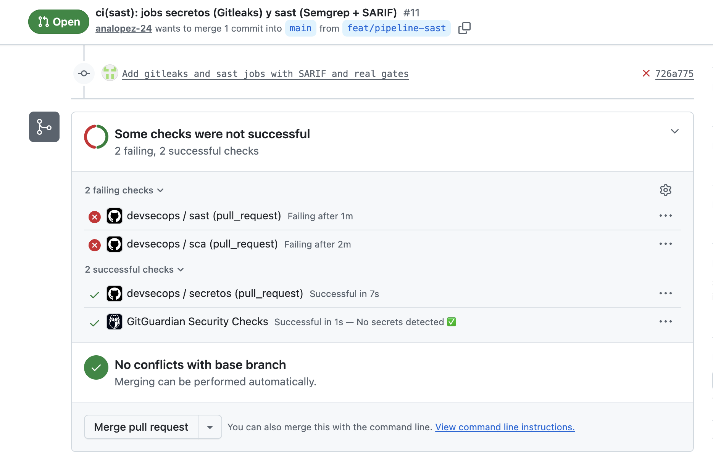
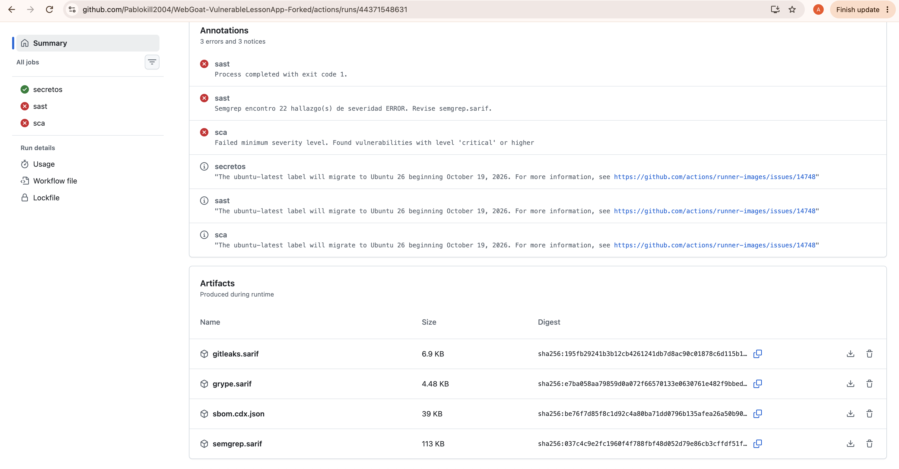
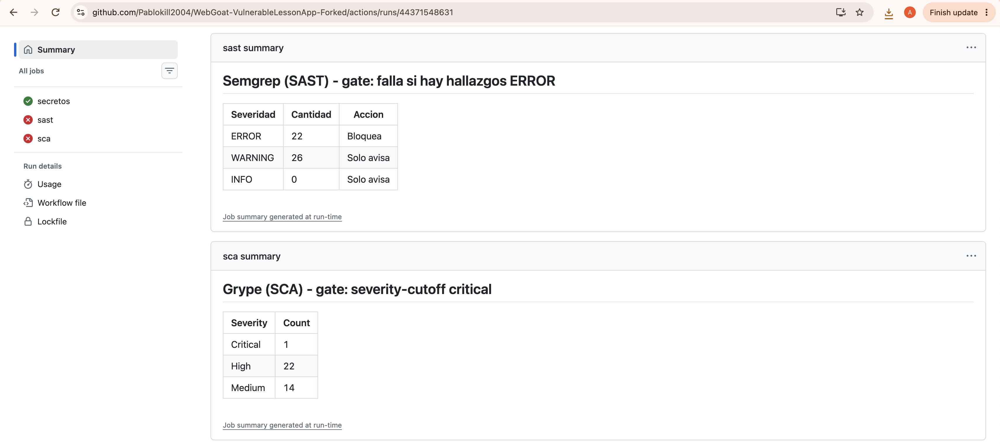
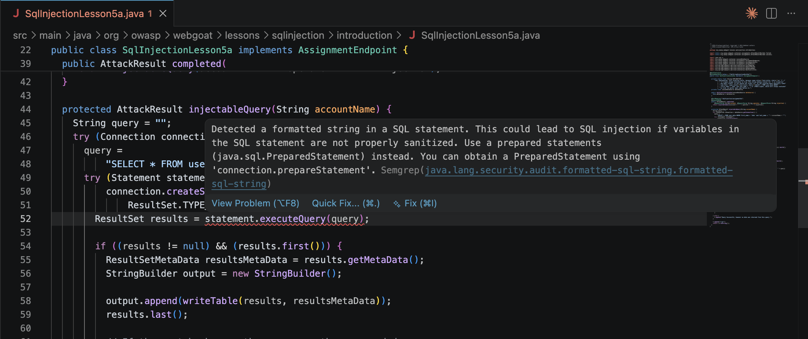

# Fase 3 — Seguridad del código: Secretos y SAST

**Aplicación:** fork de OWASP WebGoat (Java 25 / Spring Boot)

**Fecha:** 18-nov-2026

Este documento cubre los entregables del avance: estructura del repositorio, extensión SAST en VS Code,
jobs `secretos` y `sast` en el pipeline, criterio de bloqueo y análisis de los 5 hallazgos SAST más relevantes.

> **Nota:** WebGoat es una aplicación **intencionalmente vulnerable**. En esta fase el objetivo no es corregir el
> código, sino demostrar que las herramientas detectan, reportan y bloquean, y que el
> equipo distingue verdaderos positivos de falsos positivos.

---

## 1. Herramientas y configuración

| Elemento | Herramienta / versión | Ubicación en el repositorio |
|---|---|---|
| Pipeline CI/CD | GitHub Actions, se ejecuta en cada `pull_request` hacia `main` | `.github/workflows/devsecops.yml` |
| Detección de secretos | Gitleaks **8.30.1** (binario oficial verificado con SHA-256) | job `secretos` |
| SAST | Semgrep CLI **1.185.0** (versión fija vía `pipx`) | job `sast` |
| Reglas SAST públicas | `p/java` y `p/owasp-top-ten` (Semgrep Registry) | job `sast` |
| Reglas SAST propias | 3 reglas del equipo | `.semgrep/reglas-sast.yml` |
| SAST en el IDE | Extensión oficial **Semgrep** para VS Code (`p/java`) | captura en `security/vscode-semgrep-sqli.png` |

### 1.1 Controles de seguridad del propio pipeline

- **Mínimo privilegio:** `permissions: contents: read` a nivel de workflow y de cada job.
- **Acciones fijadas por SHA de commit**: `actions/checkout@3d3c42e…` (v7.0.1),
  `actions/upload-artifact@cf430e0…` (v7.0.2). Dependabot (ecosistema `github-actions`) propone las actualizaciones.
- **Herramientas con versión fija:** Gitleaks 8.30.1 con verificación de checksum, Semgrep 1.185.0.
- `persist-credentials: false` en el checkout, para que el token no quede guardado en el runner.
- **Sin secretos en el repositorio:** el pipeline no necesita ningún token adicional.
- **Sin `|| true` ni `continue-on-error`** en ningún gate.

### 1.2 Reglas SAST propias (`.semgrep/reglas-sast.yml`)

| ID | Detecta | Severidad | CWE | OWASP Top 10 | ASVS |
|---|---|---|---|---|---|
| `webgoat-sqli-concatenacion-statement` | SQL armado con `+` y ejecutado con `java.sql.Statement` | ERROR | CWE-89 | A03:2021 Injection | V5.3.4 |
| `webgoat-hash-debil-md5-sha1` | `MessageDigest.getInstance("MD5"/"SHA-1")` | WARNING | CWE-328 | A02:2021 Cryptographic Failures | V6.2.5 |
| `webgoat-credencial-hardcodeada` | Variables `password`/`secret`/`token`/`apikey` con valor literal | WARNING | CWE-798 | A07:2021 Identification and Authentication Failures | V2.10.4 |

---

## 2. Criterio de bloqueo (umbral de los gates)

| Job | Qué analiza | **Bloquea (falla el check)** | Solo avisa | Justificación |
|---|---|---|---|---|
| `secretos` | Solo los commits nuevos del PR (`base..head`) con Gitleaks | Cualquier secreto detectado (exit code 1) | — | Un secreto filtrado es de explotación inmediata y no se puede "des-publicar". Se escanean solo los commits del PR porque WebGoat incluye a propósito secretos de ejemplo en sus lecciones; escanear todo el historial bloquearía siempre por algo que no introdujo el PR. |
| `sast` | Todo el código con `p/java` + `p/owasp-top-ten` + reglas propias | ≥ 1 hallazgo de severidad **ERROR** (SARIF `level: error`) | WARNING e INFO | ERROR agrupa las clases de vulnerabilidad de alto impacto y alta confianza (inyección SQL, XXE, path traversal, SSRF). Los WARNING tienen más falsos positivos (p. ej. credenciales en datos de prueba) y bloquearlos generaría fatiga de alertas. |

El reporte `semgrep.sarif` se sube como artefacto **antes** de evaluar el gate (`if: always()`), así queda disponible
aunque el job falle. El gate escribe un resumen por severidad en la página del run (`$GITHUB_STEP_SUMMARY`).

---

## 3. Evidencia de ejecución (PR #11)

- **Pull Request:** [#11 — feat/pipeline-sast → main](https://github.com/Pablokill2004/WebGoat-VulnerableLessonApp-Forked/pull/11)
- **Run del pipeline:** [actions/runs/44371548631](https://github.com/Pablokill2004/WebGoat-VulnerableLessonApp-Forked/actions/runs/44371548631)

| Check | Resultado | Detalle |
|---|---|---|
| `secretos` | Pasa | Gitleaks no encontró secretos en el commit del PR |
| `sast` | Falla (gate funcionando) | 169 reglas sobre 1137 archivos → 48 hallazgos: 22 ERROR (bloquean), 26 WARNING (avisan) |
| `sca`  | Falla (gate funcionando) | Grype bloquea por vulnerabilidades de severidad Crítica |

Artefactos generados y descargables: `semgrep.sarif`, `gitleaks.sarif`, `sbom.cdx.json`, `grype.sarif`.

**Checks de seguridad en el PR:**



**Artefacto SARIF descargable:**



**Resumen del gate SAST:**



**Hallazgo en VS Code (extensión Semgrep):** inyección SQL en `SqlInjectionLesson5a.java`, línea 52.



### 3.1 Distribución de los hallazgos ERROR (22)

| Categoría | Regla(s) | Cantidad |
|---|---|---|
| Inyección SQL | `formatted-sql-string`, `tainted-sql-string`, `webgoat-sqli-concatenacion-statement`  | 17 |
| XXE | `documentbuilderfactory-external-general-entities-true`, `documentbuilderfactory-disallow-doctype-decl-missing` | 2 |
| Path traversal | `httpservlet-path-traversal`, `tainted-file-path` | 2 |
| SSRF | `tainted-url-host` | 1 |

---

## 4. Análisis de los 5 hallazgos SAST más relevantes

| # | Vulnerabilidad | Regla disparada | Archivo y línea | Severidad | Clasificación |
|---|---|---|---|---|---|
| 1 | Inyección SQL por concatenación | `java.lang.security.audit.formatted-sql-string` + `webgoat-sqli-concatenacion-statement` (propia) | `lessons/sqlinjection/introduction/SqlInjectionLesson5a.java:52` (y `:47`) | ERROR | Verdadero positivo |
| 2 | Inyección SQL en `ORDER BY` pese a usar `PreparedStatement` | `java.spring.security.injection.tainted-sql-string` | `lessons/sqlinjection/mitigation/Servers.java:51` | ERROR | Verdadero positivo |
| 3 | Path traversal (lista negra evadible) | `java.lang.security.httpservlet-path-traversal` | `lessons/pathtraversal/ProfileUploadRetrieval.java:100` | ERROR | Verdadero positivo |
| 4 | XXE (entidades externas habilitadas) | `java.lang.security.audit.xxe.documentbuilderfactory-external-general-entities-true` | `lessons/challenges/challenge2/ChainedXmlService.java:59` | ERROR | Verdadero positivo |
| 5 | Credencial "hardcodeada" | `webgoat-credencial-hardcodeada` (propia) | `lessons/sqlinjection/advanced/SqlInjectionLesson6b.java:42` | WARNING | Falso positivo |


### Hallazgo 1 — Inyección SQL por concatenación (Verdadero positivo)

```java
// SqlInjectionLesson5a.java
47  query =
48      "SELECT * FROM user_data WHERE first_name = 'John' and last_name = '" + accountName + "'";
49  try (Statement statement = connection.createStatement(...)) {
52    ResultSet results = statement.executeQuery(query);
```

**Causa raíz:** El parámetro `accountName` llega directo de la petición HTTP y se concatena dentro de la consulta SQL
sin parametrizar. Con un valor como `' OR '1'='1` la condición `WHERE` siempre es verdadera y se devuelven todos los
registros de `user_data`. Lo detectan dos reglas independientes: la pública `formatted-sql-string` (línea 52, donde se
ejecuta) y la regla propia del equipo (línea 47, donde se arma la cadena).

**Por qué es verdadero positivo:** El dato es controlado por el usuario y llega sin validar a `Statement.executeQuery`.

**Corrección esperada:** `PreparedStatement` con marcador `?` y `setString(1, accountName)`.

**Referencias:** CWE-89 · OWASP A03:2021 · ASVS V5.3.4.

### Hallazgo 2 — Inyección SQL en `ORDER BY` (Verdadero positivo)

```java
// Servers.java
45  public List<Server> sort(@RequestParam String column) throws Exception {
50    connection.prepareStatement(
51        "select id, hostname, ip, mac, status, description from SERVERS where status <> 'out"
52            + " of order' order by "
53            + column)
```

**Causa raíz:** Se usa `PreparedStatement`, pero el parámetro `column` se concatena en la cláusula `ORDER BY`, que
no admite marcadores `?`. Por eso la parametrización no protege nada en este caso. Un atacante puede enviar, por
ejemplo, `column=(CASE WHEN (SELECT ...) THEN id ELSE hostname END)` y extraer datos con inyección SQL ciega
según el orden de los resultados.

**Por qué es verdadero positivo:** El análisis de flujo (*taint*) de Semgrep sigue `@RequestParam column` hasta la
cadena SQL. Este hallazgo muestra que "usar PreparedStatement" no basta si se sigue concatenando.

**Corrección esperada:** Lista blanca de columnas permitidas (`id`, `hostname`, `ip`, `status`) y rechazo de
cualquier otro valor.

**Referencias:** CWE-89 · OWASP A03:2021 · ASVS V5.3.4.

### Hallazgo 3 — Path traversal (Verdadero positivo)

```java
// ProfileUploadRetrieval.java
93   var queryParams = request.getQueryString();
94   if (queryParams != null && (queryParams.contains("..") || queryParams.contains("/"))) {
95     return ResponseEntity.badRequest()...
99   var id = request.getParameter("id");
100  var catPicture = new File(catPicturesDirectory, (id == null ? ... : id) + ".jpg");
```

**Causa raíz:** El parámetro `id` se usa para construir una ruta de archivo. Existe un filtro de lista negra
(`..` y `/`), pero se aplica sobre `getQueryString()`, que está sin decodificar, mientras que `getParameter("id")`
devuelve el valor ya decodificado. Enviar `id=%2e%2e%2f%2e%2e%2fpath-traversal-secret` evade el filtro y permite
leer archivos fuera de `catPicturesDirectory`.

**Por qué es verdadero positivo:** La entrada del usuario llega a `new File(...)` sin normalización ni validación
efectiva.

**Corrección esperada:** Validar `id` como número entero, o normalizar la ruta con `Path.normalize()` y comprobar
`startsWith(catPicturesDirectory)`.

**Referencias:** CWE-22 · OWASP A01:2021 · ASVS V12.3.1.

### Hallazgo 4 — XXE: entidades externas habilitadas (Verdadero positivo)

```java
// ChainedXmlService.java
56  DocumentBuilderFactory factory = DocumentBuilderFactory.newInstance();
57  factory.setFeature(XMLConstants.FEATURE_SECURE_PROCESSING, true);
59  factory.setFeature("http://xml.org/sax/features/external-general-entities", true);
65  DocumentBuilder builder = factory.newDocumentBuilder();
```

**Causa raíz:** El parser XML se configura explícitamente con `external-general-entities = true` y no deshabilita
`disallow-doctype-decl` (segundo hallazgo de Semgrep en la línea 65). Un XML con `<!DOCTYPE>` puede declarar
entidades externas que el parser resuelve, lo que habilita lectura de archivos o peticiones a servicios internos
(XXE → SSRF). Aunque hay un `EntityResolver` propio, este decide qué URI resolver y forma parte del reto de la lección.

**Por qué es verdadero positivo:** La configuración insegura es real y explícita; el reto depende de ella.

**Corrección esperada:** `factory.setFeature("http://apache.org/xml/features/disallow-doctype-decl", true)` y
`external-general-entities = false`.

**Referencias:** CWE-611 · OWASP A05:2021 · ASVS V5.5.2.

### Hallazgo 5 — Credencial "hardcodeada" (Falso positivo)

```java
// SqlInjectionLesson6b.java
40  protected String getPassword() {
42    String password = "dave";
43    try (Connection connection = dataSource.getConnection()) {
44      String query = "SELECT password FROM user_system_data WHERE user_name = 'dave'";
        ...
51        password = results.getString("password");
```

**Por qué se disparó:** La regla propia `webgoat-credencial-hardcodeada` busca variables cuyo nombre contenga
`password` y tengan asignado un literal de 4 o más caracteres.

**Por qué es falso positivo:** `"dave"` no es una contraseña real ni un secreto. Es un valor por defecto que se
sobrescribe en la línea 51 con el valor leído de la base de datos. No da acceso a nada ni representa una
credencial de un sistema. Además, la consulta de la línea 44 es una cadena constante sin entrada de usuario; por eso
la regla de inyección SQL no la marcó, lo que confirma que esa regla distingue bien.

**Acción:** Este patrón explica por qué la regla de credenciales es WARNING (solo avisa) y no bloquea. Como
mejora se puede afinar la regla excluyendo los valores que luego se reasignan, o añadir
`// nosemgrep: webgoat-credencial-hardcodeada` con su justificación.

**Referencias:** CWE-798 (no aplica en este caso).

---

## 5. Otros hallazgos relevantes

| Regla | Archivo:línea | Comentario |
|---|---|---|
| `tainted-url-host` (SSRF) | `lessons/jwt/claimmisuse/JWTHeaderJKUEndpoint.java:57` | Verdadero positivo: la URL de la cabecera `jku` del JWT viene del atacante y el servidor descarga desde ella la llave pública con la que valida el token. |
| `use-of-md5` / `webgoat-hash-debil-md5-sha1` | `lessons/cryptography/HashingAssignment.java:39` | Verdadero positivo técnico. MD5 se usa a propósito para que el estudiante "rompa" el hash; no protege datos reales. |
| `webgoat-credencial-hardcodeada` | `src/it/.../RegistrationUITest.java:27` | Falso positivo: datos de prueba de un test de Playwright. |

---

## 6. Conclusiones

- El pipeline ejecuta en cada PR los jobs `secretos` y `sast` con gates reales. El PR #11 demuestra que `sast`
  bloquea ante 22 hallazgos ERROR y que `secretos` pasa cuando no se introducen secretos.
- Se generan reportes estándar **SARIF** descargables (`semgrep.sarif`, `gitleaks.sarif`).
- Las reglas propias encontraron 6 inyecciones SQL, 1 hash débil y 14 posibles credenciales, y ayudaron a ilustrar
  la diferencia entre verdaderos y falsos positivos.

